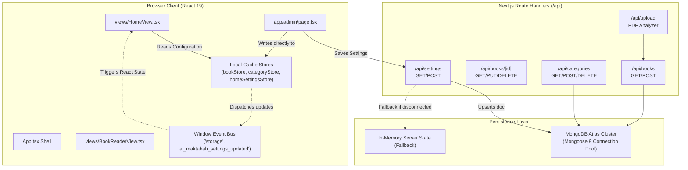

# System Architecture & Technical Specifications — Al-Maktabah

**Architecture Standard:** Modular Next.js 16 App Router + React 19 Client SPA Framework  
**Rendering Strategy:** Hybrid Static Generation (SSG) + Client-Side Dynamic Viewports + Server Route Handlers  
**Database Architecture:** MongoDB Atlas Cluster (Mongoose 9) with Client-Side Fallback Cache  

---

## 1. High-Level System Architecture Diagram



---

## 2. Directory Structure & Component Boundaries

```text
c:\Users\Star\Desktop\kashi\al-maktabah\
├── src/
│   ├── app/                          # Next.js App Router layer
│   │   ├── layout.tsx                # Root HTML, fonts, and global metadata
│   │   ├── page.tsx                  # Public Home root (renders App.tsx)
│   │   ├── admin/
│   │   │   └── page.tsx              # Authenticated Admin Portal with Tab Switcher
│   │   └── api/                      # Next.js Serverless Route Handlers
│   │       ├── books/                # Book CRUD operations
│   │       │   ├── route.ts
│   │       │   └── [id]/route.ts
│   │       ├── categories/           # Category/Discipline CRUD
│   │       │   ├── route.ts
│   │       │   └── [id]/route.ts
│   │       ├── settings/             # Homepage & Reader configuration
│   │       │   └── route.ts
│   │       ├── upload/               # PDF upload & heuristic chapter parser
│   │       │   └── route.ts
│   │       └── health/               # Database connectivity healthcheck
│   ├── components/                   # Reusable atomic UI & layout modules
│   │   ├── Header.tsx                # Fixed sticky navigation with theme/lang toggles
│   │   ├── Footer.tsx                # Waqf footer & manuscript discipline links
│   │   ├── CommandPalette.tsx        # Instant search modal (⌘K)
│   │   ├── CodexPdfReader.tsx        # Canvas PDF viewer
│   │   ├── BookDetailModal.tsx       # Metadata inspection dialog
│   │   ├── NarratorBiographyModal.tsx# Isnād node biographer
│   │   ├── MorphologyModal.tsx       # Arabic root morphology analysis dialog
│   │   └── admin/
│   │       └── AdminHomeSettingsView.tsx # Homepage & Reader configuration panel
│   ├── views/                        # Full-page client viewports
│   │   ├── HomeView.tsx              # Public home with 7 dynamic sections
│   │   ├── BookReaderView.tsx        # Chapter-by-chapter codex reading engine
│   │   ├── BrowseLibraryView.tsx     # Filterable library search grid
│   │   ├── CategoriesView.tsx        # 28 Classifications grid
│   │   ├── ReaderStudioView.tsx      # Dual-pane reader studio
│   │   ├── ManuscriptsView.tsx       # High-resolution manuscript codex gallery
│   │   └── LatestReleasesView.tsx    # Chronological recent releases
│   ├── models/                       # Mongoose Schemas & TypeScript interfaces
│   │   ├── BookModel.ts              # Detailed Book & chapter subdocument schema
│   │   ├── CategoryModel.ts          # Islamic Science classification schema
│   │   └── SettingsModel.ts          # Homepage & Reader settings document
│   ├── types/                        # Pure TypeScript domain types
│   │   ├── library.ts                # Book, IsnadNode, Footnote, ReadingSection
│   │   ├── bookContent.ts            # DetailedBook, BookChapter
│   │   └── homeSettings.ts           # HomeSectionsConfig, HomeSettings
│   ├── data/                         # Client state persistence & seed libraries
│   │   ├── bookStore.ts              # Client localStorage book cache & sync
│   │   ├── categoryStore.ts          # Client localStorage category cache
│   │   ├── homeSettingsStore.ts      # Settings store & book-to-reader mapper
│   │   └── mockLibrary.ts            # Scholarly seeds & initial constants
│   └── lib/                          # Server utilities & algorithms
│       ├── mongodb.ts                # Mongoose singleton connection manager
│       └── pdfAnalyzer.ts            # PDF parsing & chapter demarcation engine
```

---

## 3. Data Flow & State Management

1. **Initialization:**
   - On initial mount, `App.tsx` reads cached books, categories, and settings from `localStorage` using synchronous initializers `useState(() => getHomeSettings())`. This eliminates any Flash of Unstyled Content (FOUC).
   - Simultaneously, `syncFromApi()` fires asynchronous non-blocking requests to `/api/books`, `/api/categories`, and `/api/settings`. If MongoDB Atlas is connected, live data hydrates the local stores.
2. **Real-Time Cross-Component Reactivity:**
   - When an administrator modifies settings or toggles a section in `AdminHomeSettingsView.tsx`:
     1. The setting is saved immediately to `localStorage`.
     2. An `al_maktabah_settings_updated` custom event is dispatched to `window`.
     3. An asynchronous POST is dispatched to `/api/settings` for server persistence.
     4. Any active view listening on `window` immediately updates its React state.
3. **Graceful Offline Degradation:**
   - If the database connection drops or `MONGODB_URI` is omitted, the API handlers fall back to in-memory state and client stores fall back to browser `localStorage`, ensuring 100% operational availability in development and disconnected environments.
