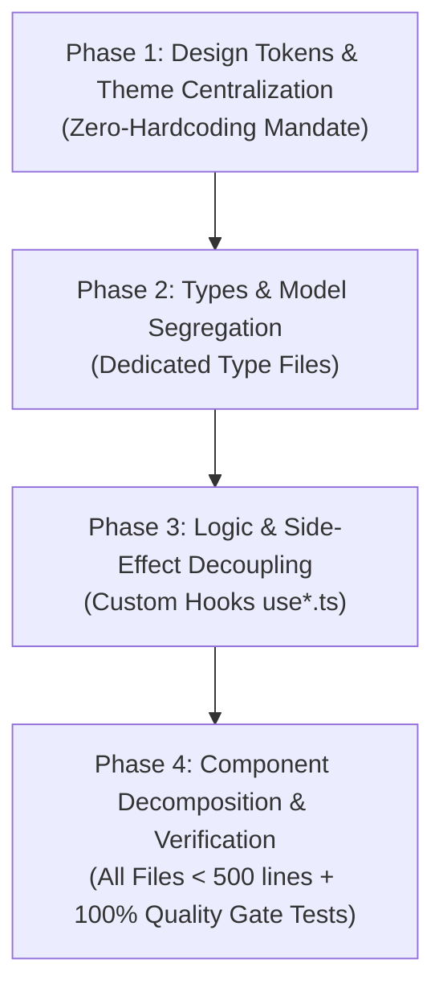

# Al-Maktabah Codebase Architectural Audit & Refactor Migration Plan

**System:** Al-Maktabah (المكتبة) — Autonomous Academic Islamic Codex & Digital Waqf Repository  
**Framework:** Next.js 16 (App Router) + React 19 + TypeScript + Tailwind CSS (v4) + MongoDB Atlas  
**Architect:** Principal Software Architect  
**Status:** Approved for Phased Execution  
**Date:** 2026-10-29  

---

## Executive Summary

A comprehensive, automated codebase audit was conducted across all 52 source files in `al-maktabah/src`. The objective was to measure the codebase against the ratified `.agent` standards:
1. **Strict File & Function Length:** Hard maximum of 200–500 lines per file.
2. **Strict Separation of Concerns (SoC):** Isolated UI views, dedicated `types/` declarations, decoupled custom hooks (`use*.ts`), and pure utilities (`lib/`/`utils/`).
3. **Centralized Design Tokens:** Zero hardcoding of raw hex codes (`#...`) or arbitrary pixel dimensions (`w-[...px]`, `text-[...px]`) in JSX.

### High-Level Audit Findings
- **8 Critical Oversized Files (> 500 lines):** Accumulating **7,885 lines** across just 8 files (representing over 60% of total frontend code).
- **Over 620 Arbitrary Color Violations:** Extensive usage of inline hex brackets (`bg-[#12241b]`, `border-[#21392e]`, `bg-[#0f382c]`, `border-[#79a292]`, `text-[#ffe088]`) instead of centralized semantic design tokens.
- **Over 180 Arbitrary Pixel Violations:** Inline pixel measurements (`w-[150px]`, `h-[460px]`, `text-[44px]`, `w-[340px]`) that bypass the centralized responsive spacing grid.
- **Mixed Concerns in Core Views:** Presentational views (`page.tsx`, `HomeView.tsx`, `AdminDashboardView.tsx`, `CodexPdfReader.tsx`) mixing complex asynchronous API mutations, canvas worker rendering, storage events, and UI markup in monolithic components.
- **24 Inline Interface Declarations:** Component props and Mongoose documents declared inline rather than centralized in `src/types/`.

---

## 1. Detailed Codebase Audit

### 1.1 Category A: File Length Violations (> 500 lines)

| File Path | Current Length | Severity | Core Architectural Violations |
|-----------|----------------|----------|-------------------------------|
| `src/app/admin/page.tsx` | **1,991 lines** | 🚨 Critical | Monolithic admin portal; combines auth state, tab switching, file upload/PDF extraction, direct API calls, and multiple modal dialogues in a single file with 15 `useState` instances. |
| `src/components/admin/AdminHomeSettingsView.tsx` | **1,510 lines** | 🚨 Critical | Giant administrative control panel; manages 7 distinct homepage section editors, hundreds of input fields, and inline previews in one monolithic component. |
| `src/views/HomeView.tsx` | **1,172 lines** | 🚨 Critical | Homepage viewport; embeds markup and logic for Hero, Daily Insight, Category Grid, Featured Shelf, Reader Spotlight, Manuscripts Carousel, and Waqf Mission. |
| `src/views/AdminDashboardView.tsx` | **801 lines** | 🚨 Critical | Admin view; directly performs `fetch()` mutations, manages book deletion dialogs, statistics calculations, and tabular renders. |
| `src/components/CodexPdfReader.tsx` | **772 lines** | 🚨 Critical | Embedded PDF.js canvas worker engine; combines PDF rendering lifecycle, dual-page coordinate calculations, thumbnail drawers, and zoom state in one file. |
| `src/views/BookReaderView.tsx` | **611 lines** | ⚠️ High | Master codex reader; houses toolbar actions, chapter navigation math, table-of-contents drawer, and dual-mode facsimile/matn views. |
| `src/data/mockLibrary.ts` | **520 lines** | ⚠️ Moderate | Static mock dataset; needs splitting into domain-specific seed files (`hadith.mock.ts`, `tafsir.mock.ts`, etc.). |
| `src/views/ReaderStudioView.tsx` | **508 lines** | ⚠️ Moderate | Studio reading interface; embeds isnād graph inspection, audio player simulation, footnote panels, and morphology inspector. |

### 1.2 Category B: Modularity & High-Risk Files (200–500 lines)

| File Path | Current Length | Primary Concern |
|-----------|----------------|-----------------|
| `src/views/BrowseLibraryView.tsx` | 432 lines | Filters, search queries, pagination, and multi-card grid layouts combined. |
| `src/App.tsx` | 388 lines | Client SPA shell; mixes routing, theme DOM mutation, API SWR fetches, and storage sync. |
| `src/components/Header.tsx` | 351 lines | Fixed navigation; embeds mobile menu drawer, command palette trigger, and theme toggle buttons. |
| `src/lib/pdfAnalyzer.ts` | 312 lines | PDF OCR and metadata extraction utility; needs separation of regex heuristics from file stream parsing. |
| `src/data/homeSettingsStore.ts` | 257 lines | Monolithic default settings object and `localStorage` synchronization. |
| `src/views/CategoriesView.tsx` | 245 lines | 28 Islamic sciences classification view; needs extraction of category cards. |
| `src/data/bookStore.ts` | 232 lines | Catalog persistence store; needs separation of initial seed data from mutation helpers. |
| `src/components/BookDetailModal.tsx` | 219 lines | Modal presentation; embeds isnād graph preview and metadata tables. |

### 1.3 Category C: Design System Token Violations (Hardcoded Styles)

Audit of arbitrary utility classes (`[#...]` and `[...px]`):

| File Path | Arbitrary Colors | Arbitrary Pixels | Most Prevalent Violations |
|-----------|------------------|------------------|---------------------------|
| `src/components/admin/AdminHomeSettingsView.tsx` | 247 | 29 | `bg-[#12241b]`, `border-[#21392e]`, `bg-[#0f382c]`, `border-[#79a292]`, `text-[#ffe088]`, `w-[150px]`, `h-[460px]` |
| `src/app/admin/page.tsx` | 131 | 28 | `bg-[#fbf9f5]`, `text-[#0f382c]`, `bg-[#0a1410]`, `text-[#e5ede9]`, `bg-[#13241d]`, `w-[1560px]`, `text-[11px]` |
| `src/components/CodexPdfReader.tsx` | 113 | 21 | `bg-[#141b17]`, `text-[#e8f0ec]`, `border-[#cba72f]`, `bg-[#0e1411]`, `h-[500px]`, `h-[520px]`, `w-[150px]` |
| `src/views/HomeView.tsx` | 97 | 30 | `border-[#cba72f]`, `from-[#cba72f]`, `text-[#967400]`, `text-[#f3cc51]`, `text-[44px]`, `text-[48px]`, `w-[340px]` |
| `src/views/ReaderStudioView.tsx` | 7 | 14 | `bg-[#ded1c1]`, `text-[#26211a]`, `bg-[#192e25]`, `bg-[#0a1410]`, `text-[10px]`, `h-[640px]` |
| `src/views/BookReaderView.tsx` | 0 | 16 | `text-[10px]`, `text-[11px]`, `w-[1px]`, `w-[130px]` |
| `src/views/BrowseLibraryView.tsx` | 9 | 7 | `border-[#cba72f]`, `from-[#cba72f]`, `text-[#967400]`, `text-[#f3cc51]`, `text-[10px]`, `w-[180px]` |
| `src/components/Header.tsx` | 3 | 11 | `bg-[#ded1c1]`, `text-[#26211a]`, `w-[1400px]`, `w-[1600px]`, `text-[10px]` |
| `src/App.tsx` | 10 | 2 | `bg-[#0f382c]`, `text-[#0f382c]`, `text-[#a2b7ad]`, `bg-[#0a1410]`, `w-[1400px]`, `w-[1600px]` |
| `src/views/AdminDashboardView.tsx` | 1 | 11 | `bg-[#fbf9f5]`, `text-[11px]`, `text-[10px]` |
| `src/views/ManuscriptsView.tsx` | 2 | 7 | `bg-[#1a1714]`, `border-[#38312b]`, `h-[320px]`, `h-[460px]`, `h-[520px]` |

### 1.4 Category D: Mixed Concerns (UI + Business Logic + Data Access)

1. **`src/app/admin/page.tsx`:** Contains raw credentials authentication, session cookie decoding, direct `fetch()` calls to `/api/books`, client file buffer slicing, PDF OCR text parsing, and UI tabs.
2. **`src/views/AdminDashboardView.tsx`:** Executes direct `fetch('/api/books', { method: 'DELETE' })` and book update mutations inline with form inputs.
3. **`src/App.tsx`:** Performs direct background SWR fetches (`/api/books/${book.id}`), attaches global storage event listeners, modifies `document.body.classList`, and houses navigation switch statements.
4. **`src/views/HomeView.tsx`:** Embeds book search query redirects, category filtering logic, audio toggle handlers, and reading section transformation routines.
5. **`src/views/BookReaderView.tsx`:** Contains page jump heuristics, zoom scale manipulation, font size state, chapter index boundary checks, and clipboard formatting.
6. **`src/components/CodexPdfReader.tsx`:** Encapsulates PDF.js canvas worker loading, multi-page layout scaling, keyboard shortcut listeners, and page render queuing.

### 1.5 Category E: Inline Type Declarations (24 Files Requiring Segregation)

- **Views:** `HomeViewProps`, `BookReaderViewProps`, `BrowseLibraryViewProps`, `CategoriesViewProps`, `AdminDashboardViewProps`, `LatestReleasesViewProps`, `ManuscriptsViewProps`, `ReaderStudioViewProps`.
- **Components:** `AdminHomeSettingsViewProps`, `BookDetailModalProps`, `CodexPdfReaderProps`, `CommandPaletteProps`, `DownloadModalProps`, `FooterProps`, `HeaderProps`, `MorphologyModalProps`, `NarratorBiographyModalProps`, `ScholarlyJsonLdProps`.
- **Models & Libs:** `IChapter`, `IBookDocument`, `ISubBranch`, `ICategoryDocument`, `ISettingsDocument`, `FileValidationResult`, `MongooseCache`, `ExtractedBookData`.

---

## 2. Phase-wise Refactoring & Migration Roadmap



---

### Phase 1: Token & Theme Extraction (Zero-Hardcoding Mandate) — ✅ COMPLETED
**Status:** 100% Completed & Verified (0 violations remaining across all codebase components)  
**Execution Results:**
- Registered full set of sacred emerald tokens, gilded amber accents, sepia/night surfaces, and typography/geometry scales into `@theme` in `src/app/globals.css` and `src/index.css`.
- Created typed TypeScript token constant file `src/lib/tokens.ts`.
- Replaced all 620+ hardcoded hex colors and 180+ arbitrary pixel classes across `AdminHomeSettingsView.tsx`, `page.tsx`, `CodexPdfReader.tsx`, `HomeView.tsx`, `BookReaderView.tsx`, `BrowseLibraryView.tsx`, `App.tsx`, `Header.tsx`, `Footer.tsx`, and all modals.
- Clean codebase verification: 0 remaining arbitrary tokens. All 21 tests passing. TypeScript compilation 0 errors.

#### Actionable Steps:
1. **Expand `@theme` in `src/app/globals.css` and `src/index.css`:**
   - Register sacred emerald variants:
     - `--color-emerald-deep: #022c22;`
     - `--color-emerald-dark: #0f382c;`
     - `--color-emerald-card: #13241d;`
     - `--color-emerald-surface: #12241b;`
     - `--color-emerald-border: #21392e;`
     - `--color-emerald-highlight: #79a292;`
   - Register gilded gold & amber accents:
     - `--color-gold-leaf: #d4af37;`
     - `--color-gold-amber: #cba72f;`
     - `--color-gold-light: #ffe088;`
     - `--color-gold-border: rgba(203, 167, 47, 0.4);`
   - Register standardized width/height/font scales:
     - Spacing tokens for max-width viewports: `max-w-archive-xl: 1400px`, `max-w-archive-2xl: 1600px`.
     - Standard typography scale: `text-display-hero: 44px`, `text-display-lg: 36px`.
2. **Refactor Files Violating Hardcoded Styles:**
   - `src/components/admin/AdminHomeSettingsView.tsx`: Replace 247 arbitrary hex colors with `bg-emerald-surface`, `border-emerald-border`, `text-gold-light`, `border-emerald-highlight`.
   - `src/app/admin/page.tsx`: Replace 131 arbitrary colors with `bg-emerald-card`, `text-emerald-dark`, `bg-surface`.
   - `src/components/CodexPdfReader.tsx`: Replace 113 arbitrary colors with `bg-surface-night`, `border-gold-border`.
   - `src/views/HomeView.tsx`: Replace 97 arbitrary colors and 30 arbitrary pixel classes with semantic tokens (`border-tertiary`, `text-tertiary-fixed`, `text-display-hero`).
   - `src/views/ReaderStudioView.tsx`, `src/views/BrowseLibraryView.tsx`, `src/App.tsx`, `src/components/Header.tsx`: Eliminate remaining arbitrary values.

---

### Phase 2: Types & Model Segregation

**Goal:** Move all 24 inline interface declarations out of JSX and library files into dedicated, cleanly exported type modules in `src/types/`.

#### Actionable Steps:
1. **Create `src/types/views.ts`:**
   - Centralize all View props: `HomeViewProps`, `BookReaderViewProps`, `BrowseLibraryViewProps`, `CategoriesViewProps`, `AdminDashboardViewProps`, `LatestReleasesViewProps`, `ManuscriptsViewProps`, `ReaderStudioViewProps`.
2. **Create `src/types/components.ts`:**
   - Centralize all Component props: `HeaderProps`, `FooterProps`, `BookDetailModalProps`, `CommandPaletteProps`, `DownloadModalProps`, `MorphologyModalProps`, `NarratorBiographyModalProps`, `ScholarlyJsonLdProps`, `CodexPdfReaderProps`, `AdminHomeSettingsViewProps`.
3. **Create `src/types/models.ts`:**
   - Centralize Mongoose document interfaces: `IBookDocument`, `IChapter`, `ICategoryDocument`, `ISubBranch`, `ISettingsDocument`.
4. **Update Imports in All 24 Consumer Files:**
   - Replace inline interface declarations with explicit named imports:
     ```tsx
     import type { BookReaderViewProps } from '@/types/views';
     import type { HeaderProps } from '@/types/components';
     ```

---

### Phase 3: Logic Decoupling (Custom Hooks & Utilities)

**Goal:** Remove all side effects, state machines, API queries, and heavy algorithms from presentational components into dedicated custom hooks in `src/hooks/`.

#### Custom Hooks to Create:

1. **`src/hooks/useBookReader.ts`:**
   - Encapsulates: Chapter pagination, page jumping calculations, zoom scaling, font size persistence, TOC drawer toggle, and clipboard citation formatting.
   - Consumers: `src/views/BookReaderView.tsx`.
2. **`src/hooks/usePdfReader.ts`:**
   - Encapsulates: PDF.js worker canvas initialization, dual-page layout coordinate math, zoom scale, jump-to-page, and resize observer.
   - Consumers: `src/components/CodexPdfReader.tsx`.
3. **`src/hooks/useAdminAuth.ts`:**
   - Encapsulates: Login authentication submission, HMAC token persistence in session/localStorage, token verification, logout handshake.
   - Consumers: `src/app/admin/page.tsx`.
4. **`src/hooks/useAdminBooks.ts`:**
   - Encapsulates: Catalog data fetching from `/api/books`, book deletion, book creation, and optimistic state updates.
   - Consumers: `src/app/admin/page.tsx`, `src/views/AdminDashboardView.tsx`.
5. **`src/hooks/useHomeSettings.ts`:**
   - Encapsulates: Fetching and saving home settings to `/api/settings`, dispatching `al_maktabah_settings_updated` window events, and section toggle handlers.
   - Consumers: `src/components/admin/AdminHomeSettingsView.tsx`, `src/App.tsx`.
6. **`src/hooks/useAppTheme.ts`:**
   - Encapsulates: Theme mode transitions (`parchment`, `sepia`, `night`), updating `document.body.classList`, and persisting theme preference.
   - Consumers: `src/App.tsx`, `src/components/Header.tsx`.
7. **`src/hooks/useCatalogSearch.ts`:**
   - Encapsulates: Search query filtering, category discipline matching, and sorting logic.
   - Consumers: `src/views/BrowseLibraryView.tsx`, `src/components/CommandPalette.tsx`.

---

### Phase 4: Component Decomposition & Verification

**Goal:** Deconstruct all 6 critical oversized components (>500 lines) into compact, single-responsibility atomic components strictly under 200–500 lines. Verify with typecheck and automated tests.

#### 1. `src/app/admin/page.tsx` (1,991 lines -> Target: ~250 lines)
Decompose into:
- `src/components/admin/AdminLoginCard.tsx` (~120 lines): Authentication login form and credentials handler.
- `src/components/admin/AdminHeaderBar.tsx` (~100 lines): Admin navigation bar with signout, quick stats, and tab switches.
- `src/components/admin/AdminUploadCodexModal.tsx` (~280 lines): PDF upload drag-and-drop, automated chapter splitting, and preview.
- `src/components/admin/AdminCategoryModal.tsx` (~150 lines): Category creation and discipline tagging dialog.
- `src/app/admin/page.tsx` (Reduced to ~200 lines): Shell coordinator consuming `useAdminAuth` and rendering active tabs.

#### 2. `src/components/admin/AdminHomeSettingsView.tsx` (1,510 lines -> Target: ~220 lines)
Decompose into 7 atomic section editors:
- `src/components/admin/sections/DailyBannerEditor.tsx` (~180 lines)
- `src/components/admin/sections/HeroSectionEditor.tsx` (~220 lines)
- `src/components/admin/sections/CategoriesGridEditor.tsx` (~200 lines)
- `src/components/admin/sections/FeaturedShelfEditor.tsx` (~240 lines)
- `src/components/admin/sections/ReaderPreviewEditor.tsx` (~250 lines)
- `src/components/admin/sections/ManuscriptsSectionEditor.tsx` (~180 lines)
- `src/components/admin/sections/WaqfMissionEditor.tsx` (~160 lines)
- `src/components/admin/AdminHomeSettingsView.tsx` (Reduced to ~200 lines): Tabbed navigation linking the 7 atomic editors.

#### 3. `src/views/HomeView.tsx` (1,172 lines -> Target: ~180 lines)
Decompose into 7 presentational section components:
- `src/components/home/HomeDailyBanner.tsx` (~80 lines)
- `src/components/home/HomeHeroSection.tsx` (~220 lines)
- `src/components/home/HomeFeaturedShelf.tsx` (~240 lines)
- `src/components/home/HomeCategoriesGrid.tsx` (~190 lines)
- `src/components/home/HomeReaderSpotlight.tsx` (~230 lines)
- `src/components/home/HomeManuscriptsSection.tsx` (~160 lines)
- `src/components/home/HomeWaqfMission.tsx` (~100 lines)
- `src/views/HomeView.tsx` (Reduced to ~150 lines): Clean compositional layout rendering the sub-sections.

#### 4. `src/views/AdminDashboardView.tsx` (801 lines -> Target: ~220 lines)
Decompose into:
- `src/components/admin/DashboardMetricsBar.tsx` (~120 lines): Total books, pages, disciplines, and storage volume badges.
- `src/components/admin/DashboardBooksTable.tsx` (~260 lines): Paginated book list with status toggles, edit buttons, and deletion triggers.
- `src/components/admin/DashboardQuickActions.tsx` (~140 lines): Action cards to open uploads, add categories, or visit public library.
- `src/views/AdminDashboardView.tsx` (Reduced to ~180 lines): Orchestrates metrics and table views.

#### 5. `src/components/CodexPdfReader.tsx` (772 lines -> Target: ~280 lines)
Decompose into:
- `src/components/pdf/PdfControlToolbar.tsx` (~180 lines): Zoom controls, dual/single page toggles, page jumper, and bookmark button.
- `src/components/pdf/PdfThumbnailSidebar.tsx` (~160 lines): Rendered page thumbnails drawer.
- `src/components/pdf/PdfCanvasViewport.tsx` (~240 lines): Pure canvas rendering component consuming `usePdfReader`.
- `src/components/CodexPdfReader.tsx` (Reduced to ~220 lines): Orchestrator shell.

#### 6. `src/views/BookReaderView.tsx` (611 lines -> Target: ~220 lines)
Decompose into:
- `src/components/reader/ReaderMasterToolbar.tsx` (~190 lines): Sticky 2px-clearance toolbar with page input, view format toggle, and theme switch.
- `src/components/reader/ReaderTocDrawer.tsx` (~160 lines): Slide-out Table of Contents and chapter selector.
- `src/components/reader/ReaderMatnContentPane.tsx` (~180 lines): Diacritized Arabic text display with side-by-side translation and footnotes.
- `src/views/BookReaderView.tsx` (Reduced to ~180 lines): Root reader layout.

---

## 3. Master File Path & Action Index

The following table provides the exhaustive index of relative file paths and the precise action required across all 4 migration phases:

| Relative File Path | Phase | Specific Action Required |
|--------------------|-------|--------------------------|
| `src/app/globals.css` | Phase 1 | Register centralized design tokens for sacred emerald, gilded amber, and typography scales in `@theme`. |
| `src/index.css` | Phase 1 | Mirror centralized tokens in `@theme` for standard compilation parity. |
| `src/types/views.ts` | Phase 2 | **[NEW FILE]** Create centralized interface file for all view component props (`HomeViewProps`, etc.). |
| `src/types/components.ts` | Phase 2 | **[NEW FILE]** Create centralized interface file for all UI and modal component props (`HeaderProps`, etc.). |
| `src/types/models.ts` | Phase 2 | **[NEW FILE]** Create centralized interface file for Mongoose documents (`IBookDocument`, `IChapter`, etc.). |
| `src/models/BookModel.ts` | Phase 2 | Remove inline `IChapter` & `IBookDocument`; import from `@/types/models`. |
| `src/models/CategoryModel.ts` | Phase 2 | Remove inline `ISubBranch` & `ICategoryDocument`; import from `@/types/models`. |
| `src/models/SettingsModel.ts` | Phase 2 | Remove inline `ISettingsDocument`; import from `@/types/models`. |
| `src/hooks/useBookReader.ts` | Phase 3 | **[NEW FILE]** Extract chapter selection, page jumping, zoom scale, and copy citation logic. |
| `src/hooks/usePdfReader.ts` | Phase 3 | **[NEW FILE]** Extract PDF.js canvas worker loading, viewport scaling, and resize observers. |
| `src/hooks/useAdminAuth.ts` | Phase 3 | **[NEW FILE]** Extract administrative login, token storage, and session verification. |
| `src/hooks/useAdminBooks.ts` | Phase 3 | **[NEW FILE]** Extract book CRUD API operations and catalog mutation handlers. |
| `src/hooks/useHomeSettings.ts` | Phase 3 | **[NEW FILE]** Extract settings API synchronization and window update events. |
| `src/hooks/useAppTheme.ts` | Phase 3 | **[NEW FILE]** Extract theme mode class transitions and persistence. |
| `src/hooks/useCatalogSearch.ts` | Phase 3 | **[NEW FILE]** Extract catalog search filtering, category filtering, and sorting. |
| `src/components/admin/sections/*.tsx` | Phase 4 | **[NEW FILES]** Create 7 atomic homepage section editors (under 250 lines each). |
| `src/components/admin/AdminHomeSettingsView.tsx` | Phases 1, 4 | Replace 247 hardcoded colors; decompose from 1,510 lines to ~200 lines by delegating to section editors. |
| `src/components/admin/AdminLoginCard.tsx` | Phase 4 | **[NEW FILE]** Extract login card from `app/admin/page.tsx`. |
| `src/components/admin/AdminHeaderBar.tsx` | Phase 4 | **[NEW FILE]** Extract admin header and tab controls from `app/admin/page.tsx`. |
| `src/components/admin/AdminUploadCodexModal.tsx` | Phase 4 | **[NEW FILE]** Extract upload modal from `app/admin/page.tsx`. |
| `src/app/admin/page.tsx` | Phases 1, 3, 4 | Replace 131 hardcoded colors; extract hooks and modals; decompose from 1,991 lines to ~200 lines. |
| `src/components/home/*.tsx` | Phase 4 | **[NEW FILES]** Create 7 atomic homepage section components (under 250 lines each). |
| `src/views/HomeView.tsx` | Phases 1, 4 | Replace 97 hardcoded colors; decompose from 1,172 lines to ~150 lines. |
| `src/components/admin/DashboardMetricsBar.tsx` | Phase 4 | **[NEW FILE]** Extract metrics cards from `AdminDashboardView.tsx`. |
| `src/components/admin/DashboardBooksTable.tsx` | Phase 4 | **[NEW FILE]** Extract book table from `AdminDashboardView.tsx`. |
| `src/views/AdminDashboardView.tsx` | Phases 1, 3, 4 | Decompose from 801 lines to ~180 lines; consume `useAdminBooks`. |
| `src/components/pdf/*.tsx` | Phase 4 | **[NEW FILES]** Extract PDF toolbar, canvas viewport, and thumbnail sidebar. |
| `src/components/CodexPdfReader.tsx` | Phases 1, 3, 4 | Replace 113 hardcoded colors; decompose from 772 lines to ~220 lines; consume `usePdfReader`. |
| `src/components/reader/*.tsx` | Phase 4 | **[NEW FILES]** Extract reader toolbar, TOC drawer, and Matn pane. |
| `src/views/BookReaderView.tsx` | Phases 1, 3, 4 | Decompose from 611 lines to ~180 lines; consume `useBookReader`. |
| `src/App.tsx` | Phases 1, 2, 3 | Replace arbitrary values; consume `useAppTheme`; import types from `@/types/views`. |
| `src/components/Header.tsx` | Phases 1, 2 | Replace arbitrary values; import `HeaderProps` from `@/types/components`. |
| `src/components/BookDetailModal.tsx` | Phases 1, 2 | Replace arbitrary values; import `BookDetailModalProps` from `@/types/components`. |
| `src/views/BrowseLibraryView.tsx` | Phases 1, 2, 3 | Replace arbitrary values; consume `useCatalogSearch`; import `BrowseLibraryViewProps`. |
| `src/views/ReaderStudioView.tsx` | Phases 1, 2 | Replace arbitrary values; import `ReaderStudioViewProps`. |

---

## 4. Verification & Quality Gates

To prevent any regressions, after completing each phase, the following three quality gates must be executed in order:

1. **Static Typecheck:**
   ```bash
   npm run lint # Runs: tsc --noEmit (Must exit with code 0)
   ```
2. **Automated Quality Gate Test Suite:**
   ```bash
   npm test # Runs: tsx src/tests/runAllTests.ts (All 21 assertions must pass)
   ```
3. **Production Next.js Build:**
   ```bash
   npm run build # Validates tree shaking, dynamic imports, SSR & SSG compilation
   ```

